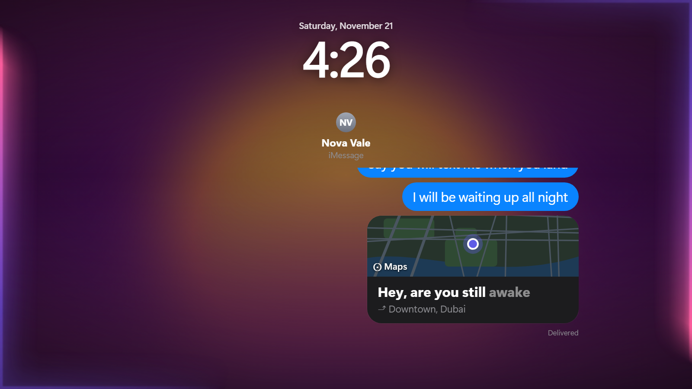
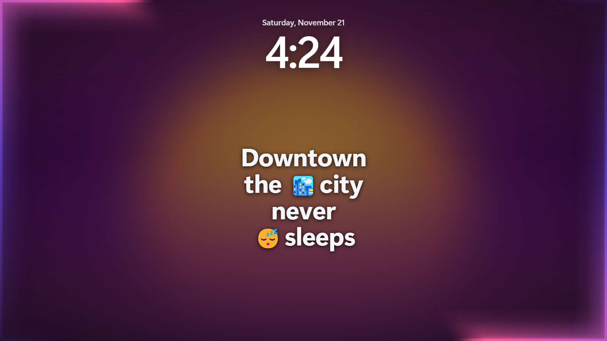
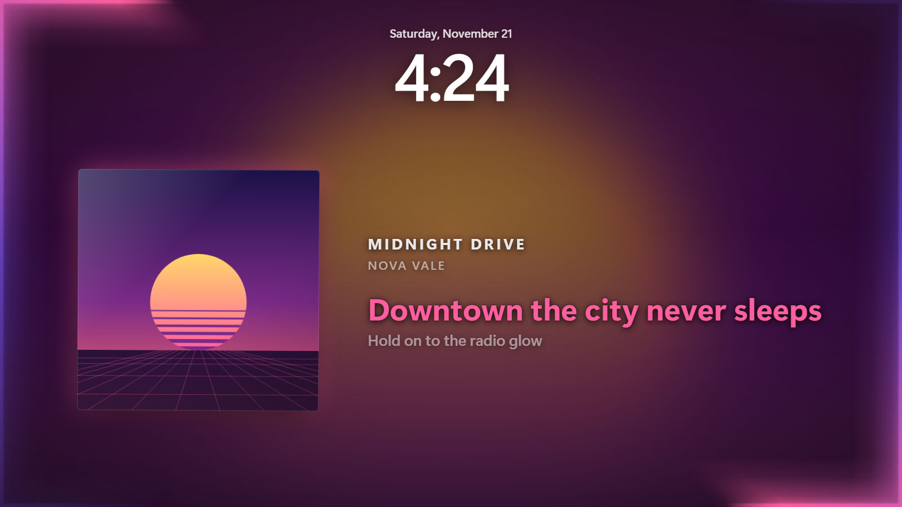
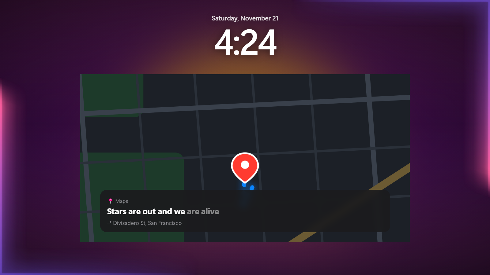
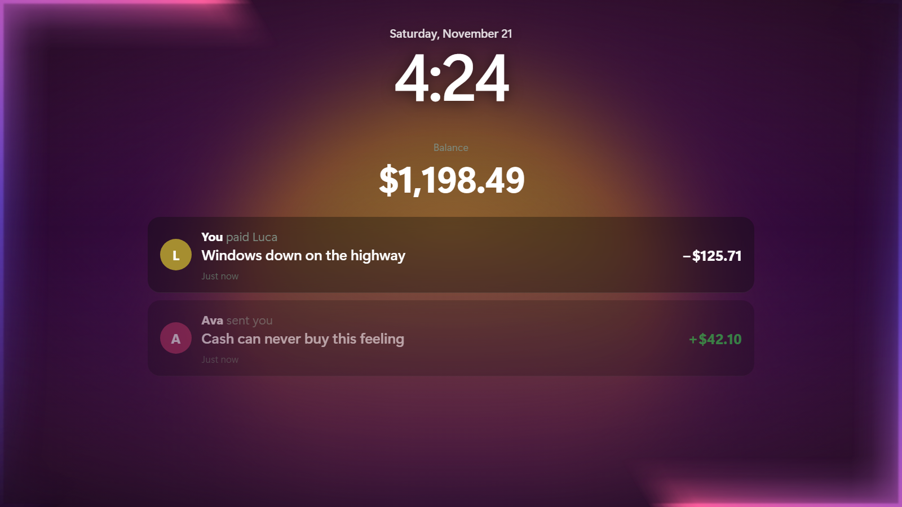
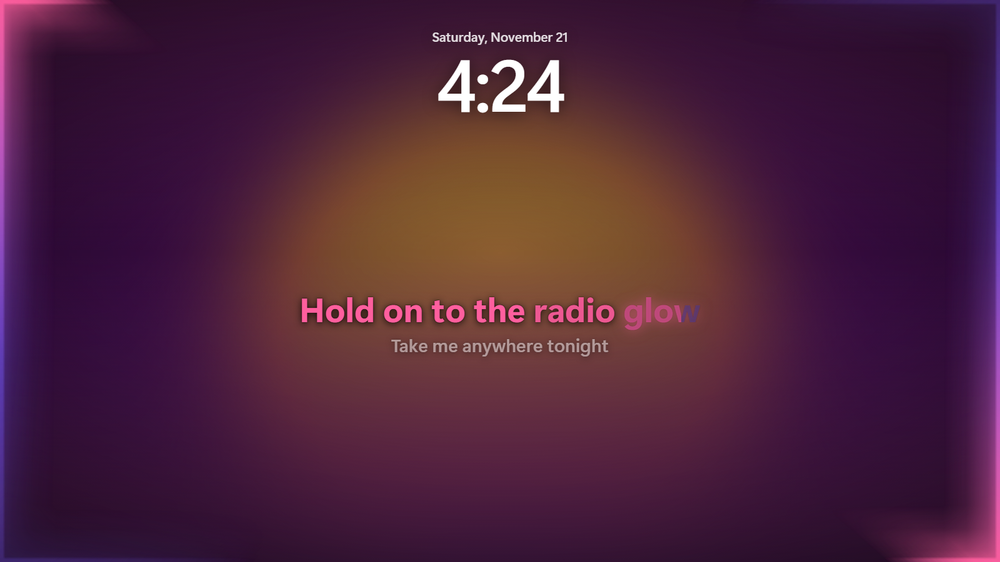
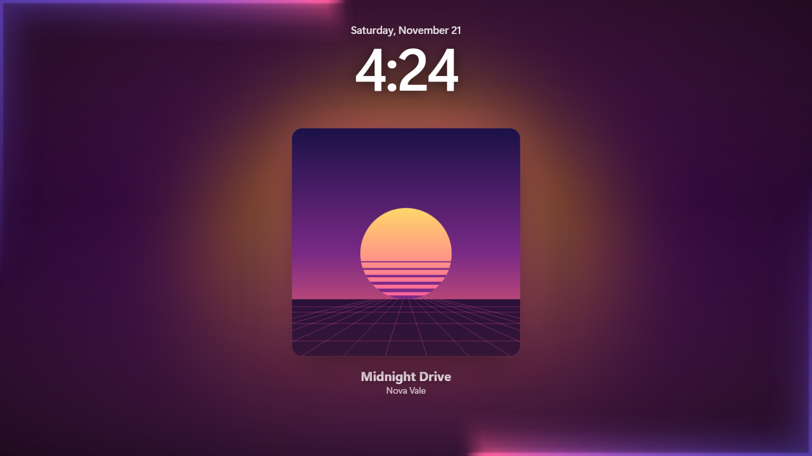
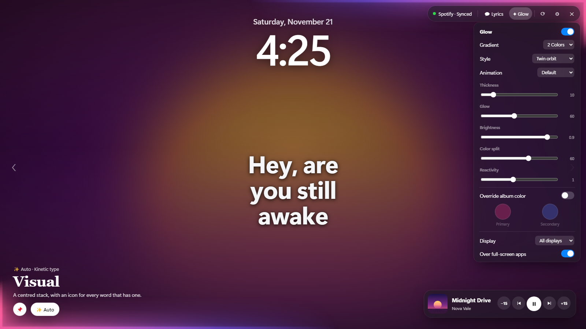
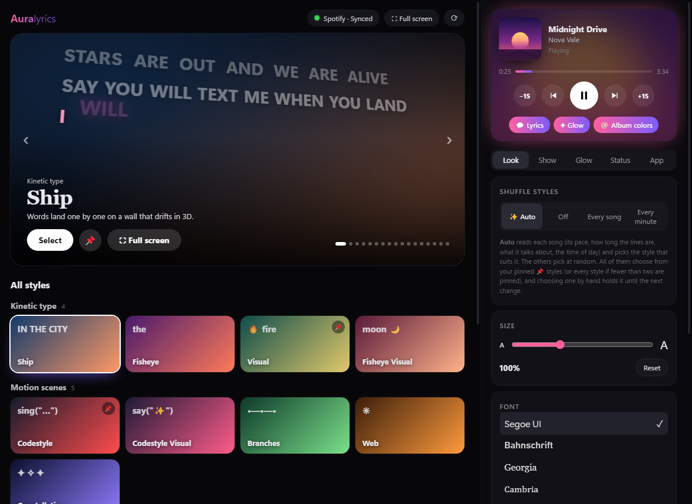

<div align="center">

# Aura<sub>lyrics</sub>

### Synced lyrics and an ambient glow for everything you play on Windows.

Full-screen, word-by-word synced lyrics in 17 styles, wrapped in a rim of light that takes its colours from the album cover and moves with the beat.<br>
Works with **Spotify, Apple Music, YouTube** and anything else Windows can see playing. No account, no sign-in.


[](LICENSE)
[](../../releases/latest)
[](CHANGELOG.md)

<br>



</div>

<br>

## Why Auralyrics

Most lyrics apps give you a text box. Auralyrics turns your whole screen into the song.

- **Synced, word by word.** Words light up as they are sung, using real per-word timing when a song has it and estimated timing otherwise.
- **17 lyric styles.** Kinetic type, motion scenes, iPhone-style screens (Messages, Money, Maps, Notifications), classic layouts, and a cover-art poster.
- **Auto style.** Auralyrics reads each song and picks the style that suits it. A fast, clipped track goes kinetic, a song about a highway gets the Maps screen, a late-night ballad gets Poster.
- **An ambient glow.** Five glow styles, led by **Twin orbit**: two comets circling the edge of your screen in the two strongest colours of the album cover, pulsing with the beat.
- **Click the cover.** In full screen, click the small cover to see it big, click again for the lyrics.
- **Quiet and private.** Reads what is playing from Windows media controls. Audio is analysed locally for the beat and is never recorded or sent anywhere.

<br>

## See it

<table>
  <tr>
    <td width="50%"><br><sub><b>Visual</b> — kinetic type, with an icon for every word that has one</sub></td>
    <td width="50%"><br><sub><b>Poster</b> — the cover as a poster, the sung line beside it</sub></td>
  </tr>
  <tr>
    <td width="50%"><br><sub><b>Maps</b> — every line pinned somewhere on the map</sub></td>
    <td width="50%"><br><sub><b>Money</b> — the song as a run of payments</sub></td>
  </tr>
  <tr>
    <td width="50%"><br><sub><b>Karaoke</b> — one big line that fills with colour as it is sung</sub></td>
    <td width="50%"><br><sub><b>Cover view</b> — click the cover in the player; click again for the lyrics</sub></td>
  </tr>
</table>

<br>

## Lyric styles

| Family | Styles |
|---|---|
| **Kinetic type** | Ship · Fisheye · Visual · Fisheye Visual |
| **Motion scenes** | Codestyle · Codestyle Visual · Branches · Web · Constellation |
| **Native Design** (iPhone screens) | Messages · Money · Maps · Notifications |
| **Classic** | Stack · Karaoke · Minimal |
| **Album cover** | Poster |

### Auto picks for you

Turn on **Auto** (it is the default) and Auralyrics chooses a style for every song. Once the lyrics load it looks at:

- **Pace and line length**: fast, short lines lean kinetic; slow, long lines lean calm.
- **What the song is about**: money, places, the night sky, texting and calling.
- **The time of day**: late at night it leans towards quieter styles.

It then picks at random, weighted by how well each style fits, so it never gets predictable and never repeats the style on screen. It chooses from your pinned 📌 styles, or from all of them if you have pinned fewer than two. Prefer to choose yourself? Pick any style and it stays until the next song, or switch Auto off. **Shuffle** is also there if you want pure random: a new style every song or every minute.

<br>

## The glow

A rim of light around your screen, in the two strongest colours of the album cover.

| Style | Look |
|---|---|
| **Twin orbit** (default) | Two comets circling the screen edge |
| **Orbit** | One comet circling the edge |
| **Rim** | The whole edge lit evenly |
| **Corners** | Four corner blooms |
| **Top & bottom** | Top and bottom edges only, sides clear |

Animation modes: **Music Sync** (follows the beat), **Default** (a steady flow), **Idle** (slow breathing) or **None**. Choose one or two colours, follow the album or set your own, and tune thickness, glow, brightness, reactivity and speed. The glow can run on all displays, the main display, or one monitor of your choice, and it can hide over full-screen apps. Sizes follow your screen, so it looks the same on a laptop, an ultrawide or a 4K monitor.

<p align="center"></p>

<br>

## The app

A main window with a live preview of every style, a gallery, the player, and all settings. Auralyrics then lives in the system tray, so it stays out of your way.

<p align="center"></p>

<br>

## Getting started

1. Download the latest release from the [Releases page](../../releases/latest): `Auralyrics-Setup-<version>.exe` to install, or `Auralyrics-<version>-portable.exe` to run without installing. Verify the download against `SHA256SUMS.txt` on the same page. Builds are not code-signed yet, so Windows SmartScreen may ask you to confirm ("More info" → "Run anyway").
2. Play something in Spotify, Apple Music or a browser tab.
3. Press **Ctrl + Alt + L** for full-screen lyrics.

Auralyrics lives in the system tray (bottom-right, `^`). The tray menu holds what you reach for mid-song: playback, style and Auto, desktop lyrics, text size, and which display glows.

### Shortcuts

| | |
|---|---|
| **Ctrl + Alt + L** | Open / close full-screen lyrics from anywhere |
| **← / →** (in full screen) | Previous / next lyric style |
| **C** (in full screen) | Show the cover / back to the lyrics |
| **H** (in full screen) | Hide / show the lyrics |
| **Space** | Play / pause |
| **+ / −** | Bigger / smaller lyrics |
| **Esc** | Close the open panel, then leave full screen |

### Floating lyrics

Not in full screen? A click-through lyrics window sits on your desktop, with hover controls to move and resize it.

<br>

## FAQ

**Which players does it work with?**
Spotify, Apple Music, YouTube and YouTube Music in a browser, and any app that shows up in Windows' media controls.

**Do I need an account?**
No. There is no sign-in and nothing to connect. Auralyrics reads what Windows says is playing.

**Where do the lyrics come from?**
[LRCLIB](https://lrclib.net), a free and open lyrics database. When a song has real per-word timing it is used, otherwise word timing is estimated within each line. The Status tab shows which one you are getting. Very new or niche releases are sometimes missing; the glow still works.

**Does it record my audio?**
No. It reads the PC's audio **output** locally to find the beat. It never uses the microphone, and no audio leaves your computer.

**What gets sent over the network?**
Only the song title, artist and length, to LRCLIB, to find the lyrics.

**Will it slow my PC down?**
The glow and lyrics are built to be light: colours are drawn only when they change, and per frame only the position and opacity are updated. It also rests while your PC is locked or asleep.

**It does not see my player.**
Start a song, then use **Reconnect to the player** on the Status tab. Some players only appear once they have played audio.

<br>

## Privacy

- Now playing is read locally from Windows media controls: no account, no login.
- Audio is read from the PC's output to find the beat, never the microphone, and is never stored or uploaded.
- The only network request is to LRCLIB, with the song title, artist and length.

<br>

## Build from source

```powershell
npm install
npm start                 # run from source
npm run dist              # build dist\Auralyrics-Setup-<version>.exe and a portable .exe
```

Debug helpers: `AURALYRICS_DEBUG=1` prints the log to the console (it is always written to `%APPDATA%\Auralyrics\auralyrics.log`). `AURALYRICS_SHOT=<folder>` renders the windows off-screen and saves screenshots. `dev-gallery.html` shows every lyric style side by side in demo mode (serve the folder over http to view it).

### How it's built

| File | Role |
|---|---|
| `main.js` | Electron main process: windows, tray, settings, lyrics lookup, hotkey, power events |
| `media.ps1` | PowerShell bridge to Windows media controls (track, art, timeline, controls, full-screen detection) |
| `audio.html` | Hidden window: system-audio loopback beat analysis and album-art palette extraction |
| `glow.js` | Shared edge-glow renderer (desktop overlay and full-screen view) |
| `engine.js` / `engine.css` | Lyrics engine and all 17 styles |
| `autostyle.js` | Auto: scores every style against the song's lyrics and the time of day |
| `stage.html` | Full-screen lyrics view with the settings bar |
| `lyrics.html` | Floating desktop lyrics |
| `panel.html` | Main window: live style preview, gallery, player, settings, status checklist |
| `overlay.html` | Click-through glow overlay, one per display |
| `preload.js` | Safe IPC bridge for the pages |

<br>

## Upgrading from Glowrim

Auralyrics is the new name of Glowrim. On first launch it copies your Glowrim settings across, so your style, glow and display choices carry over. Uninstall the old Glowrim afterwards, and turn off its "Start with Windows" entry if you used it.

<br>

## Contributing

Bug reports, ideas and pull requests are welcome. Read [CONTRIBUTING.md](CONTRIBUTING.md) first: commits need a sign-off (`git commit -s`), and contributions are licensed as described there.

<br>

## License

Auralyrics is source-available under the [PolyForm Noncommercial License 1.0.0](LICENSE). You can use it, read the code, modify it and share it for noncommercial purposes. Keep the licence and the `Required Notice:` line in [LICENSE](LICENSE) with any copy you share.

Selling Auralyrics, or using it in a paid product or service, needs a commercial licence. Get in touch: [support@cloudfall.in](mailto:support@cloudfall.in)

Lyrics are provided by [LRCLIB](https://lrclib.net) and remain the property of their rightful owners.
